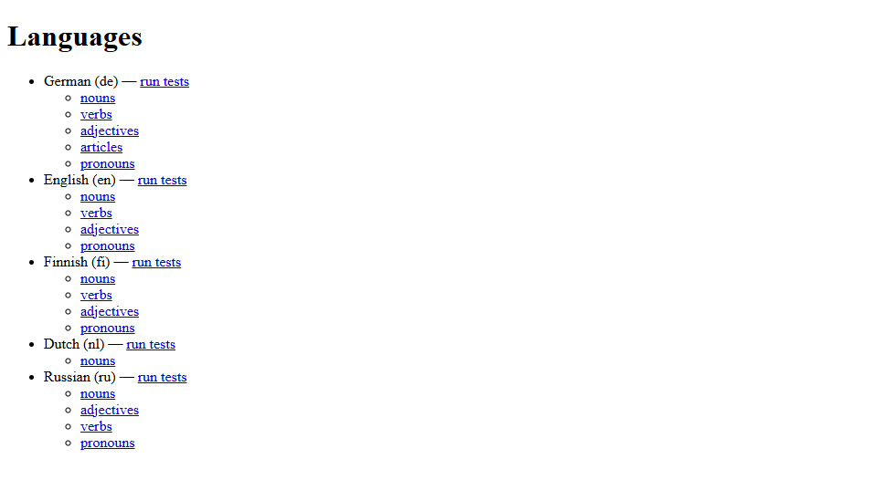
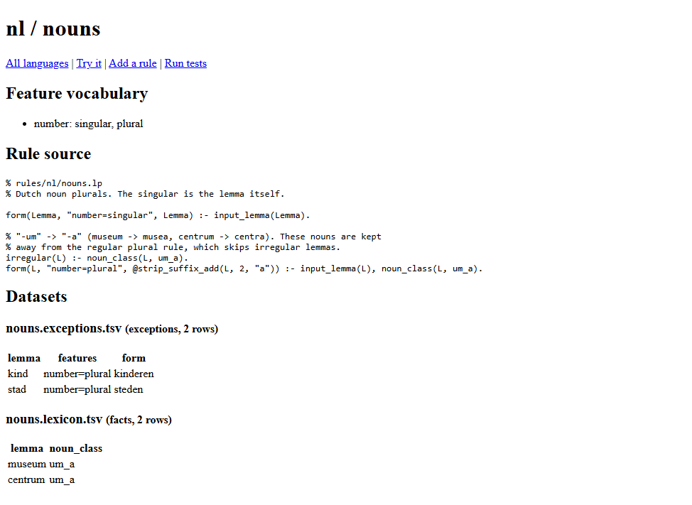
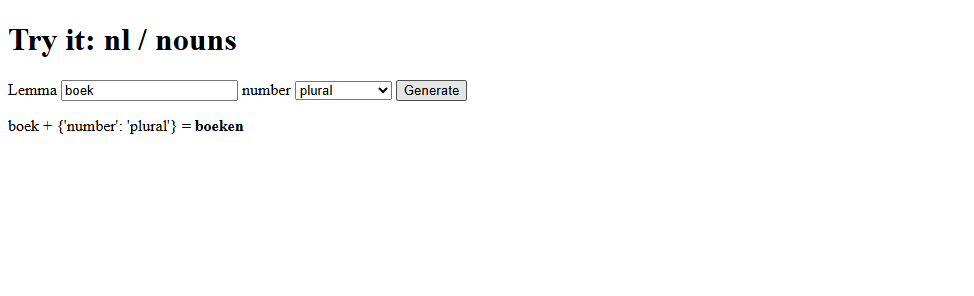
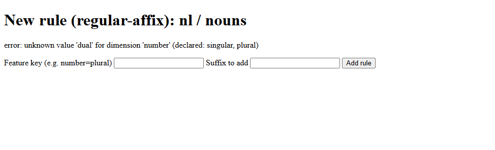
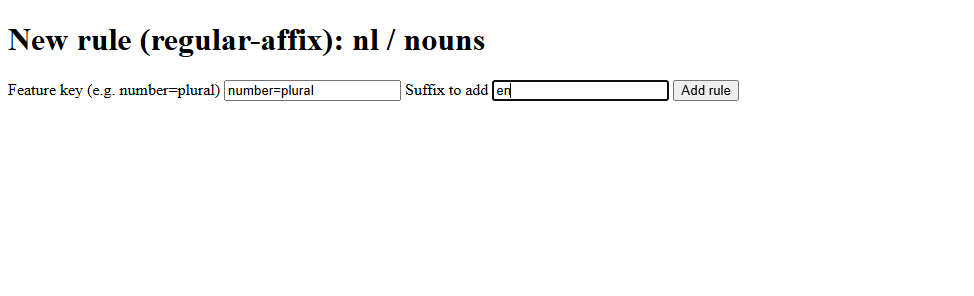
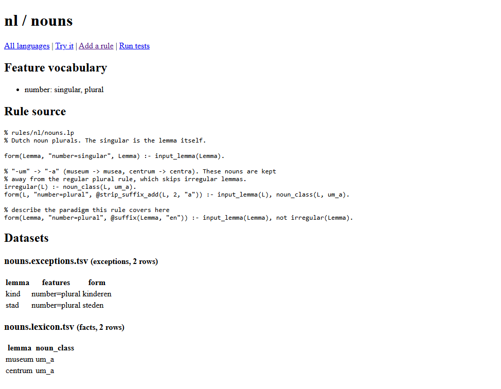
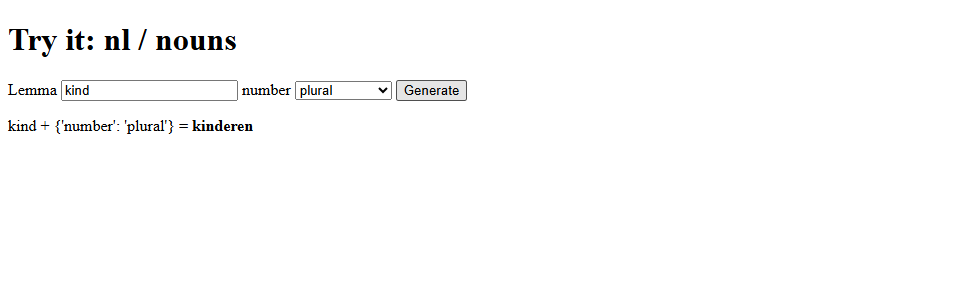
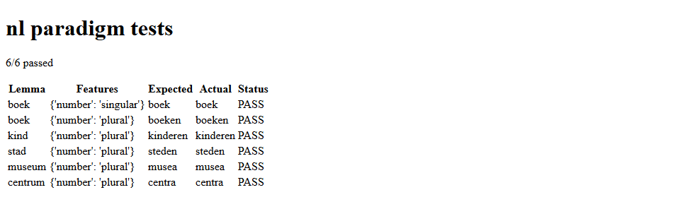
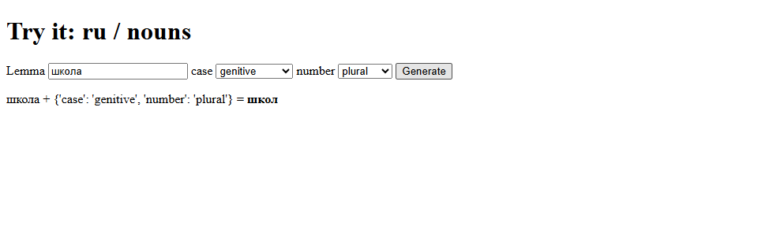

# lingua-rules

**English** | [Русский](README.ru.md)

A system for linguists to author, browse, and test natural language grammar
rules. Rules are written as Clingo (Answer Set Programming) files, organized
per language and word category, and executed locally — no database, no
external service. The rule files hold only logic; exceptions, word lists and
other lexical data are kept in tab-separated datasets next to them. Rules for **English, German, Russian and Finnish** —
nouns, verbs, adjectives, pronouns and (German) articles — are included.

The full design is in `docs/superpowers/specs/2026-09-05-lingua-rules-design.md`.

This README shows how to run lingua-rules with plain `python` (no shell aliases,
no `lingua-rules` command on your `PATH`, no activated virtual environment), how
rule templates work, which templates exist, and how to change them or add your
own. Every command and output below was run against this repository.

- [1. Install](#1-install)
- [2. Run the tools with `python -m`](#2-run-the-tools-with-python--m)
- [3. The web UI](#3-the-web-ui)
- [4. Rule files](#4-rule-files)
  - [4.1 Datasets: exceptions and other lists](#41-datasets-exceptions-and-other-lists)
- [5. Rule templates](#5-rule-templates)
- [6. Worked example: adding a language (Dutch)](#6-worked-example-adding-a-language-dutch)
- [7. Changing templates](#7-changing-templates)
- [8. Languages included](#8-languages-included)
- [9. Golden-file tests](#9-golden-file-tests)
- [10. Pitfalls and known limitations](#10-pitfalls-and-known-limitations)
- [11. Regenerating the screenshots](#11-regenerating-the-screenshots)

---

## 1. Install

You need **Python 3.11 or newer** and `git`.

```
git clone https://github.com/DenisBaliuckij/lingua-rules.git
cd lingua-rules
```

Create a virtual environment and install the package into it. You never have
to *activate* it: every command below calls the environment's own interpreter
directly.

**Windows (PowerShell or cmd):**

```
python -m venv .venv
.venv\Scripts\python.exe -m pip install -e ".[dev]"
```

**Linux / macOS:**

```
python3 -m venv .venv
.venv/bin/python -m pip install -e ".[dev]"
```

In the rest of this README, `python` means that interpreter:
`.venv\Scripts\python.exe` on Windows, `.venv/bin/python` on Linux/macOS.
(If you prefer, activate the environment once and plain `python` will do.)

### Running without installing the package

You can also run straight from the source tree. Install only the dependencies,
then put `src/` on `PYTHONPATH`:

```
python -m pip install "clingo>=5.7" "typer>=0.12" "fastapi>=0.110" "python-multipart>=0.0.9" "jinja2>=3.1" "uvicorn>=0.29" "pyyaml>=6.0"
```

| Shell | Command |
|---|---|
| PowerShell | `$env:PYTHONPATH = "src"; python -m lingua_rules.cli.main generate en nouns child --features number=plural` |
| cmd | `set PYTHONPATH=src` then `python -m lingua_rules.cli.main generate en nouns child --features number=plural` |
| Linux / macOS | `PYTHONPATH=src python -m lingua_rules.cli.main generate en nouns child --features number=plural` |

Output: `children`.

---

## 2. Run the tools with `python -m`

Every command is `python -m lingua_rules.cli.main <command> ...`. Run them from
the repository root: by default they read rules from `./rules` and tests from
`./tests`. Every command accepts `--rules-dir` (and `test`/`serve` also
`--tests-dir`) to point elsewhere.

```
python -m lingua_rules.cli.main --help
python -m lingua_rules.cli.main <command> --help
```

| Command | What it does |
|---|---|
| `generate LANG CATEGORY LEMMA --features k=v[,k=v]` | Produce one word form |
| `test [LANG] [--category C]` | Run golden-file tests (all languages if `LANG` is omitted) |
| `lint LANG` | Check rule files and datasets: Clingo parse errors, undeclared features, malformed or inconsistent tables |
| `new-rule LANG CATEGORY --template T ...` | Add a rule or a dataset row written from a template (section 5) |
| `serve [--host H] [--port P]` | Start the web UI (section 3) |

Examples with their real output:

```
> python -m lingua_rules.cli.main generate en nouns cat --features number=plural
cats
> python -m lingua_rules.cli.main generate en nouns child --features number=plural
children

> python -m lingua_rules.cli.main test en --category nouns
[PASS] cat {'number': 'plural'} expected='cats' actual='cats'
[PASS] cat {'number': 'singular'} expected='cat' actual='cat'
[PASS] child {'number': 'plural'} expected='children' actual='children'
...
21/21 passed

> python -m lingua_rules.cli.main lint en
en: no issues found
```

Errors are one line and the exit code is 1:

```
> python -m lingua_rules.cli.main generate en nouns cat --features number=dual
error: unknown value 'dual' for dimension 'number' (declared: singular, plural)
```

> **Note.** `python -m lingua_rules` (without `.cli.main`) does **not** work:
> the package has no `__main__.py`. Always use `lingua_rules.cli.main`.

### Output encoding

The CLI always writes its output as UTF-8, so letters such as ä, ö, ü, ß or
Cyrillic work everywhere — in a console window, redirected to a file, or piped
to another program — including on Windows with a legacy code page such as 1251:

```
python -m lingua_rules.cli.main generate de nouns Mann --features case=nominative,number=plural > result.txt
```

`result.txt` contains `Männer` (UTF-8). Open such files as UTF-8 in your editor.

---

## 3. The web UI

```
python -m lingua_rules.cli.main serve
python -m lingua_rules.cli.main serve --host 0.0.0.0 --port 9000
python -m lingua_rules.cli.main serve --rules-dir D:\work\rules --tests-dir D:\work\tests
```

Then open http://127.0.0.1:8000 (or the host/port you chose). Stop it with
Ctrl+C.

To run it under uvicorn directly, set the two directory variables yourself
(the web app reads them on every request; they default to `rules` and `tests`):

| Shell | Command |
|---|---|
| PowerShell | `$env:LINGUA_RULES_DIR = "rules"; $env:LINGUA_TESTS_DIR = "tests"; python -m uvicorn lingua_rules.web.app:app --port 8000` |
| Linux / macOS | `LINGUA_RULES_DIR=rules LINGUA_TESTS_DIR=tests python -m uvicorn lingua_rules.web.app:app --port 8000` |

What the UI offers (screenshots from the worked example in section 6):

**Languages** — every language under `rules/`, its categories, and a link to
its tests.



**Category page** — the feature vocabulary and the full rule source, with links
to *Try it*, *Add a rule* and *Run tests*.



**Try it** — type a lemma, pick feature values, press *Generate*. The form
shows only the features that category's rules use. Features that every rule of
the category uses are preselected; the others start at *— not set —* and are
left out of the request unless you pick a value (for Russian verbs, for
example, `verb_form` is preselected while `person`, `number` and `gender`
start unset, because the present and the past use different ones).



**Add a rule** — adds a `regular-affix` rule (the only template the web form
offers; use the CLI for the others). **Run tests** — the golden-file tests as a
table. Both are shown step by step in section 6.

---

## 4. Rule files

Each language is a folder `rules/<code>/`:

| File | Content |
|---|---|
| `lang.yaml` | `name`, optional `iso639_3`, and the list of `categories` |
| `features.yaml` | `dimensions`: each feature and its allowed values |
| `<category>.lp` | Clingo (Answer Set Programming) rules for that category — **logic only** |
| `data/<category>.<table>.tsv` | **Datasets**: exceptions, word lists, class properties, paradigm tables (section 4.1) |

```yaml
# rules/en/lang.yaml
name: English
iso639_3: eng
categories:
  - nouns
  - verbs
  - adjectives
  - pronouns
```

```yaml
# rules/en/features.yaml
dimensions:
  number:
    values: [singular, plural]
  verb_form:
    values: [base, present_3sg, past, past_participle, present_participle]
  degree:
    values: [positive, comparative, superlative]
  case:
    values: [subject, object, possessive_determiner, possessive_pronoun, reflexive]
```

```prolog
% rules/en/nouns.lp (shortened)
form(Lemma, "number=singular", Lemma) :- input_lemma(Lemma).
form(Lemma, "number=plural", @suffix(Lemma, "s")) :- input_lemma(Lemma), not irregular(Lemma), not has_class(Lemma).
```

```
# rules/en/data/nouns.exceptions.tsv (tab-separated)
lemma	features	form
child	number=plural	children
```

How a rule file is evaluated:

- The lemma you ask for arrives as the fact `input_lemma("cat")`.
- The category's datasets (section 4.1) are added as facts: the row above
  becomes `irregular("child"). form("child", "number=plural", "children").`
- Every rule derives `form(Lemma, FeatureKey, Form)`. The tool returns the
  `Form` whose `Lemma` and `FeatureKey` match the request.
- The **feature key** is a string: `dimension=value` pairs, **sorted
  alphabetically by dimension** and joined with `;` — for example
  `number=plural`, or `case=genitive;number=plural` when there are two
  dimensions. `new-rule` and the web form write keys in this order for you, in
  whatever order you type them; `lint` reports a hand-written key in any other
  order and prints the correct one.
- `irregular("x")` marks a lemma as an exception. Rules that end with
  `not irregular(Lemma)` then skip it, so its forms must be given explicitly.
- A category needs its `.lp` file to exist before the category page will open.

String helpers you can call from a rule (Clingo has no string operators, so
these are Python functions called with `@`):

| Helper | Result | Example |
|---|---|---|
| `@suffix(Lemma, "s")` | lemma + suffix | `cat` → `cats` |
| `@prefix(Lemma, "un")` | prefix + lemma | `happy` → `unhappy` |
| `@strip_suffix_add(Lemma, 2, "en")` | drop the last N letters, then add a string | `Museum` → `Museen` |
| `@affix(Lemma, 1, "wa", 0, "")` | drop letters at the start and at the end, add a prefix and an ending | `mtu` → `watu` |

### 4.1 Datasets: exceptions and other lists

A rule file holds **logic only**: how a class of words forms its plural, when
the accusative equals the genitive, and so on. Everything that is a *list*
rather than a rule — irregular forms, which class a word belongs to, which
nouns are animate, a class's gender, the endings of a paradigm table — is kept
in **datasets**: tab-separated tables under `rules/<code>/data/`, one set per
category. They are turned into Clingo facts every time a form is generated, so
the rules read them exactly as if they were written in the `.lp` file.

Tables are plain text (UTF-8, one row per line, cells separated by a **tab**),
so they can be edited in any editor or in a spreadsheet (save as *Tab-delimited
text, UTF-8*). Blank lines and lines starting with `#` are ignored. Cells are
never quoted.

There are four kinds of table, chosen by the file name:

| File | Columns | Becomes |
|---|---|---|
| `<category>.exceptions.tsv` | `lemma`, `features`, `form` | `irregular("lemma").` once per lemma, and `form("lemma", "key", "form").` per row |
| `<category>.paradigms.tsv` | `class`, `features`, `strip`, `ending` | `paradigm_ending(class, "key", strip, "ending").` — used by the `class-paradigm` rule (section 5) |
| ... with `strip_front` and `prefix` columns too | `class`, `features`, `strip_front`, `prefix`, `strip`, `ending` | `paradigm_affix(class, "key", strip_front, "prefix", strip, "ending").` — for languages that inflect at the front of the word (Swahili `mtu` → `watu`), used by the `class-paradigm-affix` rule |
| `<category>.variants.tsv` | `lemma`, `features`, `form`, `variety` | `admit("lemma", "key", "form", variety).` — a form a dialect uses next to the standard one (below) |
| `<category>.<anything else>.tsv` (e.g. `lexicon`, `classes`) | a key column, then one column per predicate | one fact per filled cell (below) |

**Dialects.** A dialect whose grammar differs from the standard language (other
endings, other classes) is described as a language of its own, e.g.
`rules/fr_acadian/`. A dialect that only uses some other forms of the same
grammar stays in the main language: its forms go to `<category>.variants.tsv`,
one row per form, with the dialect's name in `variety`. The rules still
generate the standard form; `generate` and the web *Try it* page list the
admitted forms under it (`parlent`, then `also admitted (acadian): parlont`), and a golden test
case can require them:

```yaml
  - features: {person: "3", number: plural, tense: present}   # parler
    expected: parlent
    admitted: {acadian: parlont}   # or a list: {acadian: [parlont, parlant]}
```

In a **fact table** the first column is the key — usually `lemma`, or `class`
for a table of class properties — and every other column header names a
predicate, optionally with a type after a colon:

| Type | Header example | Cell | Fact |
|---|---|---|---|
| `constant` (default) | `noun_class` | `m_hard` | `noun_class("стол", m_hard).` |
| `string` | `adj_stem:string` | `dunkl` | `adj_stem("dunkel", "dunkl").` |
| `number` | `syllables:number` | `2` | `syllables("Hund", 2).` |
| `flag` | `animate:flag` | `yes` (empty = no) | `animate("студент").` |

The key column is a string when it is called `lemma`, otherwise a constant;
write `class:constant` or `lemma:string` to be explicit. A row may leave cells
empty, and the same lemma may appear in several rows (facts add up — e.g. a
word in two classes). Columns named `source` and `note` are for people (where a
row comes from, a comment) and produce no facts. Feature keys may be written in
any order (`number=plural;case=genitive` or with `,`); they are sorted when
the table is read.

Examples from the repository (`rules/ru/data/`):

```
# nouns.lexicon.tsv
lemma	noun_class	animate:flag
стол	m_hard
студент	m_hard	yes

# nouns.classes.tsv
class:constant	class_gender	acc_from_nominative:flag
m_hard	masculine	yes
f_a	feminine

# nouns.exceptions.tsv
lemma	features	form
ребёнок	case=nominative;number=plural	дети
```

**Loading.** For a lemma-keyed table (exceptions, and fact tables whose key is
`lemma`) only the requested lemma's rows are loaded, so tables can grow to
thousands of words without slowing down `generate`. Class-keyed tables and
paradigm tables are always loaded whole.

**Checks.** `lint` reads every table and reports, with file and line:
malformed headers and cells (a class name with a capital letter, an unknown
type, a flag that is not `yes`), undeclared features, the same lemma and key
listed with two different forms, a predicate column that no rule uses (usually
a typo in the header), and constants that no rule, table or feature value
knows (usually a misspelt class name). `generate` and `test` report a broken
table instead of a form.

The web UI's category page shows each table below the rule source.

---

## 5. Rule templates

A template is a ready-made piece of grammar that the tool fills in for you.
**Rule templates** append a block to the end of `rules/<lang>/<category>.lp`;
**data templates** add a row to a table in `rules/<lang>/data/` (creating the
file with its header if needed). After that it is ordinary text: you can edit
or delete it like any other line.

Before writing, the tool checks that all required fields are present, that
feature dimensions and values are declared in `features.yaml`, and that no value
contains a line break (or, in a table, a tab). Quotes and backslashes are
escaped automatically. A data template refuses to add a row that contradicts
one already in the table (the same lemma and key with another form) and names
the line to edit instead.

### Available templates

| Template | Writes to | Use it for | Required fields | CLI flags |
|---|---|---|---|---|
| `regular-affix` | `.lp` | A regular rule that adds a suffix to every non-exception lemma (also in the web UI, *Add a rule*) | feature key, suffix | `--feature-key`, `--suffix` |
| `regular-prefix` | `.lp` | The same with a prefix (`happy` → `unhappy`) | feature key, prefix | `--feature-key`, `--prefix` |
| `class-paradigm` | `.lp` (+ creates `paradigms.tsv`) | One rule that builds every form of a class from a paradigm table | class predicate | `--class-predicate` |
| `class-paradigm-affix` | `.lp` (+ creates `paradigms.tsv` with `strip_front`, `prefix`) | The same for prefixes and suffixes together (`@affix`) | class predicate | `--class-predicate` |
| `exception-override` | `exceptions.tsv` | One irregular lemma with an explicit form | lemma, feature key, form | `--lemma`, `--feature-key`, `--form` |
| `admitted-variant` | `variants.tsv` | A dialect form admitted next to the standard one | lemma, feature key, form, variety | `--lemma`, `--feature-key`, `--form`, `--variety` |
| `paradigm-ending` | `paradigms.tsv` | One cell of a paradigm table: a class's ending (and, in an affix table, prefix) for a feature key | class, feature key (the rest optional) | `--class`, `--feature-key`, `--strip`, `--ending`, `--strip-front`, `--prefix` |
| `lexicon-entry` | `lexicon.tsv` | A word's value for one predicate, e.g. its class or a flag | lemma, predicate, value | `--lemma`, `--predicate`, `--value`, `--value-type` |

**`regular-affix`**

```
python -m lingua_rules.cli.main new-rule nl nouns --template regular-affix --feature-key number=plural --suffix en
```

appends:

```prolog

% describe the paradigm this rule covers here
form(Lemma, "number=plural", @suffix(Lemma, "en")) :- input_lemma(Lemma), not irregular(Lemma).
```

Replace the comment line with a short description of the paradigm.

**`exception-override`**

```
python -m lingua_rules.cli.main new-rule nl nouns --template exception-override --feature-key number=plural --lemma kind --form kinderen
```

adds a row to `rules/nl/data/nouns.exceptions.tsv` (the rule file is not
touched):

```
lemma	features	form
kind	number=plural	kinderen
```

which the rules see as `irregular("kind"). form("kind", "number=plural", "kinderen").`
`irregular("kind")` switches off **every** rule ending in
`not irregular(Lemma)` for `kind`, not only the plural one. If a language has
several regular rules, give each irregular lemma all the forms those rules would
have produced (repeat the command with other feature keys, or add rows by hand).

**`class-paradigm`, `paradigm-ending`, `lexicon-entry`** — a declension or
conjugation class written as a table instead of one rule per form. This is the
natural shape for a grammar's paradigm tables:

```
python -m lingua_rules.cli.main new-rule pl nouns --template class-paradigm --class-predicate noun_class
python -m lingua_rules.cli.main new-rule pl nouns --template paradigm-ending --class f_a --feature-key "case=genitive;number=singular" --strip 1 --ending y
python -m lingua_rules.cli.main new-rule pl nouns --template paradigm-ending --class f_a --feature-key "case=nominative;number=singular"
python -m lingua_rules.cli.main new-rule pl nouns --template lexicon-entry --lemma lampa --predicate noun_class --value f_a
```

The first command appends one rule to `nouns.lp`:

```prolog
form(Lemma, Key, @strip_suffix_add(Lemma, Strip, Ending)) :- input_lemma(Lemma),
    noun_class(Lemma, Class), paradigm_ending(Class, Key, Strip, Ending), not irregular(Lemma).
```

the next two fill `data/nouns.paradigms.tsv` (`strip` = letters dropped from
the lemma, `ending` = what is added; an empty ending is allowed):

```
class	features	strip	ending
f_a	case=genitive;number=singular	1	y
f_a	case=nominative;number=singular	0
```

and the last one puts `lampa` into class `f_a` in `data/nouns.lexicon.tsv`
(`lampa` → genitive `lampy`). `lexicon-entry` adds the column if the table
does not have it yet; `--value-type string|number|flag` sets its type
(default `constant`).

### Rules without a template

Anything the templates don't cover is written by hand in the `.lp` file, using
the helpers from section 4. Keep the rule general and put the words it applies
to in a table. For example, a stem change shared by several nouns:

```prolog
% "-um" -> "-en": drop the last two letters, add "en" (Museum -> Museen)
form(L, "number=plural", @strip_suffix_add(L, 2, "en")) :- input_lemma(L), noun_class(L, um_en).
```

```
# data/nouns.lexicon.tsv
lemma	noun_class
Museum	um_en
Zentrum	um_en
```

A word that is irregular in its own way goes to `exceptions.tsv` with its
forms. Run `python -m lingua_rules.cli.main lint <lang>` after editing by hand.

---

## 6. Worked example: adding a language (Dutch)

This walkthrough adds a new language, Dutch (`nl`), with one category, and
uses three templates (an exception, a lexicon entry, a regular rule) and one
hand-written class rule. It is exactly what
`docs/screenshots/capture.py` does (in a temporary copy) to produce the
screenshots; Dutch is only an example and is not part of the repository's
rules.

**Step 1 — create the language files.**

`rules/nl/lang.yaml`

```yaml
name: Dutch
iso639_3: nld
categories:
  - nouns
```

`rules/nl/features.yaml`

```yaml
dimensions:
  number:
    values: [singular, plural]
```

`rules/nl/nouns.lp` — start with the singular, which is the lemma itself:

```prolog
% rules/nl/nouns.lp
% Dutch noun plurals. The singular is the lemma itself.

form(Lemma, "number=singular", Lemma) :- input_lemma(Lemma).
```

**Step 2 — add irregular plurals with `exception-override`.**

```
python -m lingua_rules.cli.main new-rule nl nouns --template exception-override --feature-key number=plural --lemma kind --form kinderen
python -m lingua_rules.cli.main new-rule nl nouns --template exception-override --feature-key number=plural --lemma stad --form steden
```

Each prints `added exception-override row to rules\nl\data\nouns.exceptions.tsv`;
`nouns.lp` itself is unchanged.

**Step 3 — add a hand-written class rule** at the end of `rules/nl/nouns.lp`,
and put the words it applies to in the lexicon:

```prolog
% "-um" -> "-a" (museum -> musea, centrum -> centra). These nouns are kept
% away from the regular plural rule, which skips irregular lemmas.
irregular(L) :- noun_class(L, um_a).
form(L, "number=plural", @strip_suffix_add(L, 2, "a")) :- input_lemma(L), noun_class(L, um_a).
```

```
python -m lingua_rules.cli.main new-rule nl nouns --template lexicon-entry --lemma museum --predicate noun_class --value um_a
python -m lingua_rules.cli.main new-rule nl nouns --template lexicon-entry --lemma centrum --predicate noun_class --value um_a
```

The category page now shows the rule file and, below it, the two tables:


**Step 4 — add the regular plural with the web form** (`serve`, open *nl →
nouns → Add a rule*). The form checks the feature key against
`features.yaml`; a value that is not declared is rejected:



With a valid key (`number=plural`, suffix `en`):



After *Add rule* you are returned to the category page with the new block at
the end (the CLI equivalent is the `regular-affix` command in section 5):



**Step 5 — try it.** A regular noun uses the new rule; an exception uses its
override:




The same from the command line:

```
> python -m lingua_rules.cli.main generate nl nouns boek --features number=plural
boeken
> python -m lingua_rules.cli.main generate nl nouns museum --features number=plural
musea
```

**Step 6 — add golden-file tests** in `tests/nl/nouns.paradigm.yaml` (format in
section 9) and run them — on the command line with
`python -m lingua_rules.cli.main test nl`, or in the UI via *Run tests*:



---

## 7. Changing templates

There are two different things you may want to change.

### 7.1 Change a rule or a row that a template has already written

Open `rules/<lang>/<category>.lp` (rules) or the table in `rules/<lang>/data/`
(rows) in any text editor and edit it. The template is not remembered anywhere;
the file is the only source of truth. Then run `lint` and `test`.

### 7.2 Change what a template writes, or add a new template

Templates live in `src/lingua_rules/engine/templates.py`. A **rule template** is
a Python string with `{field}` placeholders, registered in `_RULE_TEMPLATES`,
plus a list of required fields:

```python
REGULAR_AFFIX_TEMPLATE = (
    "\n"
    "% describe the paradigm this rule covers here\n"
    'form(Lemma, "{feature_key}", @suffix(Lemma, "{suffix}")) :- '
    "input_lemma(Lemma), not irregular(Lemma).\n"
)

_RULE_TEMPLATES = {
    "regular-affix": REGULAR_AFFIX_TEMPLATE,
    "regular-prefix": REGULAR_PREFIX_TEMPLATE,
    "class-paradigm": CLASS_PARADIGM_TEMPLATE,
}

_TEMPLATE_REQUIRED_FIELDS = {
    "regular-affix": ("feature_key", "suffix"),
    ...
}
```

**Data templates** (`exception-override`, `paradigm-ending`, `lexicon-entry`)
are listed in `_DATA_TEMPLATES` and written by `_append_data()` in the same
file, which picks the table, creates it with its header and adds the row.

**To change an existing rule template**, edit its string — for example the
comment line. Keep the `{...}` placeholders and keep every placeholder inside
`"..."` quotes in the Clingo text (values are escaped for use inside a quoted
string). Only rules added from then on are affected; existing `.lp` files are
not rewritten.

**To add a rule template**, e.g. `circumfix` for a prefix and a suffix added
together (Indonesian `adil` → `keadilan`):

1. In `src/lingua_rules/engine/templates.py`, add the text and register it:

   ```python
   CIRCUMFIX_TEMPLATE = (
       "\n"
       "% describe the paradigm this rule covers here\n"
       'form(Lemma, "{feature_key}", @prefix(S, "{prefix}")) :- input_lemma(Lemma),\n'
       '    not irregular(Lemma), S = @suffix(Lemma, "{suffix}").\n'
   )

   _RULE_TEMPLATES = {
       ...
       "circumfix": CIRCUMFIX_TEMPLATE,
   }

   _TEMPLATE_REQUIRED_FIELDS = {
       ...
       "circumfix": ("feature_key", "prefix", "suffix"),
   }
   ```

2. In `src/lingua_rules/cli/main.py`, `new-rule` already has `--prefix` and
   `--suffix` flags, so this template needs nothing more. A template with a
   new field needs a new option and an entry in the `fields` dictionary:

   ```python
       infix: str = typer.Option(None, "--infix"),
   ```

   ```python
       fields = {
           ...
           "infix": infix,
       }
   ```

3. Use it:

   ```
   > python -m lingua_rules.cli.main new-rule demo nouns --template circumfix --feature-key derivation=abstract --prefix ke --suffix an
   appended circumfix scaffold to rules\demo\nouns.lp
   > python -m lingua_rules.cli.main generate demo nouns adil --features derivation=abstract
   keadilan
   ```

4. Run `python -m pytest` and add a test for the new template under
   `tests_unit/engine/test_templates.py`.

The web form (*Add a rule*) is fixed to `regular-affix`; offering another
template there means changing `new_rule_submit` in `src/lingua_rules/web/app.py`
and `src/lingua_rules/web/templates/new_rule.html`.

---

## 8. Languages included

Four languages, every major inflecting part of speech. Each rule file starts
with a comment that lists its classes and what it does **not** cover.

| Language | Category | Features | Classes | Irregular words | Golden cases |
|---|---|---|---|---|---|
| English (`en`) | nouns | number | template rules + spelling rules | 18 | 21 |
| | verbs | verb_form (base, 3sg, past, past participle, -ing) | 4 + doubled consonant | 58 | 105 |
| | adjectives | degree | 3 + doubled consonant | 6 | 42 |
| | pronouns | case, number | listed | — | 40 |
| German (`de`) | nouns | case (4) × number | 10 declension classes | 12 | 128 |
| | verbs | infinitive, present, past, participle, imperative × person, number | 3 weak classes | 24 strong/modal | 206 |
| | adjectives | degree; strong/weak/mixed declension × case × gender × number | regular + stem classes | 13 | 145 |
| | articles | case × gender × number | der; ein-words; der-words | — | 92 |
| | pronouns | case, number | listed | — | 36 |
| Russian (`ru`) | nouns | case (6) × number, animacy | 16 declension classes | 14 | 372 |
| | adjectives | case × gender × number, animacy; comparative | 4 (hard, soft, velar, hushing) | 10 comparatives | 161 |
| | verbs | infinitive, present, past (by gender), imperative; future of быть | 4 conjugation classes | 18 | 165 |
| | pronouns | case, number | listed | — | 48 |
| Finnish (`fi`) | nouns | case (12, incl. accusative) × number | 15 inflection classes | 8 | 480 |
| | verbs | infinitive, present, past, imperative × person, number | 12 (types 1, 3, 4, 5) | 15 | 270 |
| | adjectives | degree | 4 | 10 | 33 |
| | pronouns | case (12), number | listed | — | 72 |

**How the rules are organised.** English and German regular words need no
entry at all (the template-style rules cover them). Where the right ending
depends on how a word is spelled or which class it belongs to — which a rule
cannot see — each word is given its class in a table, and every class has one
rule per form:

```
# rules/ru/data/nouns.lexicon.tsv
lemma	noun_class	animate:flag
школа	f_a
```

```prolog
% rules/ru/nouns.lp
form(L, "case=genitive;number=plural", @strip_suffix_add(L, 1, "")) :- input_lemma(L), noun_class(L, f_a).
```

To add a word of an existing class, add one row to the category's
`lexicon.tsv` (column `noun_class`, `verb_class` or `adj_class`). A word
without a class (in the languages that need one) produces no forms, and
`generate` reports `no rule ... produced a form`. Truly irregular words are
listed with all their forms in `exceptions.tsv`. The `.lp` files of the four
languages contain no words at all; every list is under `rules/<code>/data/`:

| Language | Tables |
|---|---|
| `en` | `{nouns,verbs,adjectives}.lexicon.tsv`, `{nouns,verbs,adjectives,pronouns}.exceptions.tsv` |
| `de` | `{nouns,verbs,adjectives,articles}.lexicon.tsv`, `{nouns,verbs,adjectives,articles,pronouns}.exceptions.tsv` |
| `ru` | `{nouns,verbs,adjectives}.lexicon.tsv`, `nouns.classes.tsv` (gender, accusative), `{nouns,verbs,pronouns}.exceptions.tsv` |
| `fi` | `{nouns,verbs,adjectives}.lexicon.tsv`, `{nouns,verbs,adjectives,pronouns}.exceptions.tsv` |

*Try it* shows each category only the features its rules use:



```
> python -m lingua_rules.cli.main generate fi nouns talo --features case=inessive,number=plural
taloissa
> python -m lingua_rules.cli.main generate ru verbs рисовать --features number=plural,person=third,verb_form=present
рисуют
> python -m lingua_rules.cli.main generate de adjectives klein --features case=dative,declension=strong,gender=masculine,number=singular
kleinem
```

**Regenerating the rules.** The larger rule files and their datasets are
produced from tables by `tools/gen_en.py`, `tools/gen_de.py`, `tools/gen_ru.py`
and `tools/gen_fi.py` (run from the repository root). To add many words or a
new class, edit the tables there and re-run the script; the golden tests are
regenerated from separately typed-out word forms. A script rewrites all rule
files, datasets and test files of its language, so edits made directly in a
generated `.lp` or `.tsv` file (including rules and rows added with templates)
are lost the next time it runs: make them in the script. Only
`rules/en/nouns.lp`, its two tables, its tests and newly added languages are
written by hand.

---

## 9. Golden-file tests

Each file `tests/<lang>/<category>.paradigm.yaml` holds one or more YAML
documents separated by `---`, one per lemma:

```yaml
lemma: boek
category: nouns
cases:
  - features: {number: singular}
    expected: boek
  - features: {number: plural}
    expected: boeken
---
lemma: kind
category: nouns
cases:
  - features: {number: plural}
    expected: kinderen
```

```
python -m lingua_rules.cli.main test nl
python -m lingua_rules.cli.main test nl --category nouns
python -m lingua_rules.cli.main test            # every language under tests/
```

The unit tests of the tool itself run with `python -m pytest`.

---

## 10. Pitfalls and known limitations

- **Feature-key order in hand-written rules.** Keys must be sorted by
  dimension name (`number=plural;tense=past`). Templates sort them for you;
  for rules you type yourself, run `lint`, which reports any key in another
  order, for example:
  `[verbs] feature key 'tense=past;number=plural' is not in canonical order and will never match; write 'number=plural;tense=past'`.
- **`irregular` is all-or-nothing** per lemma (see section 5).
- **Try it with forms that use different features.** Where some forms of a
  category use features others don't (Russian verbs: `person` in the present,
  `gender` in the past), those features start at *— not set —*; set exactly the
  ones the form you want needs.
- **The web form only adds `regular-affix` rules**; use `new-rule` for the
  other templates.
- **No undo.** Templates append to the file; remove unwanted blocks or rows by
  editing the `.lp` file or the table.
- **Tabs, not spaces, in tables.** Editors that turn a tab into spaces break a
  row; `lint` then reports it (`... cells but the header has ... columns`, or a
  value that is not a constant). In a spreadsheet, save as tab-delimited UTF-8
  text, not CSV.
- **Tables are read per lemma.** A rule that compares one lemma with another
  (`... :- noun_class(L, C), noun_class(Other, C)`) only sees the requested
  lemma's rows of a lemma-keyed table; put such cross-word data in a
  class-keyed table.
- `lint` (not `generate`) prints Clingo's notes such as
  `info: atom does not occur in any rule head: irregular(Lemma)` for a category
  with no exceptions yet; they are harmless.

---

## 11. Regenerating the screenshots

The screenshots in `docs/images/` are made with Selenium by
`docs/screenshots/capture.py`. It builds the Dutch example in a temporary
copy of `rules/` and `tests/` (the repository's own files are not changed),
starts the web UI, and captures each page in a headless browser.

```
python -m pip install -e ".[docs]"
python docs/screenshots/capture.py                 # Microsoft Edge
python docs/screenshots/capture.py --browser chrome
```

Selenium downloads the matching browser driver automatically.
